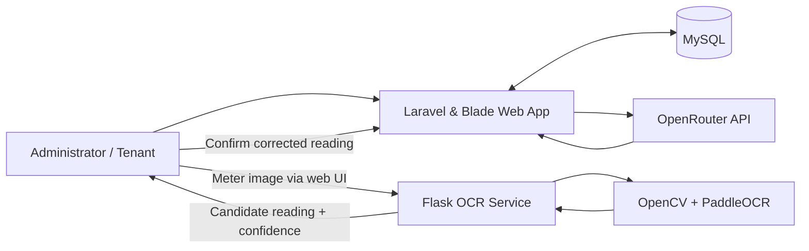

# BoardingHub — Boarding House Management with OCR and AI Chatbot

**Graduation project | Ninh Quang Khai | Thuyloi University (2026)**

BoardingHub is a web-based boarding house management system that helps administrators manage rental operations and gives tenants a self-service portal. The project combines conventional full-stack development with two practical AI integrations: **OCR-assisted utility meter reading** and a **context-aware chatbot**.

> **Project scope:** This is an academic implementation and technical portfolio project. The OCR component uses a pretrained PaddleOCR model, while the chatbot integrates an external language-model API through OpenRouter. The repository does **not** claim to train a new foundation model or to have production-validated AI accuracy.

## 1. Project Overview

Manual boarding house administration can involve fragmented records, repeated data entry, and time-consuming communication about rent, utility usage, invoices, and maintenance requests. BoardingHub brings these tasks into one application with separate experiences for administrators and tenants.

Two AI-assisted workflows complement the core system:

- **OCR-assisted meter readings:** Capture or upload a photo of a utility meter, extract a candidate numerical reading, display a confidence indicator, and allow an administrator to verify or correct the value before recording it.
- **AI chatbot:** Answer questions using a language-model API together with selected information retrieved from the application's database according to the signed-in user's role.

## 2. Key Features

| Administrator | Tenant |
| --- | --- |
| Manage buildings, rooms, and room availability | View assigned room and rental information |
| Manage tenants, room members, and contracts | View invoices and payment status |
| Configure services and parking cards | Read announcements |
| Record electricity and water readings, with optional OCR assistance | Submit maintenance requests |
| Create, preview, print, and manage invoices | Update profile information |
| Publish notices and handle maintenance requests | Ask questions through the AI chatbot |
| View dashboard summaries, settings, and system logs | |

These features are reflected in the Laravel controllers, routes, models, and Blade views of the project.

## 3. AI Integration

### 3.1 OCR-Assisted Utility Meter Reading

The OCR component is a separate **Python Flask service** that uses **OpenCV, NumPy, and PaddleOCR**. Image preprocessing and multiple crop/recognition attempts are used to obtain a candidate reading from a meter photograph.

**Workflow**

1. An administrator selects a room and meter type, then uploads or captures a meter photo.
2. The browser sends the image to the Flask `/ocr` endpoint.
3. The OCR service processes the image and returns a candidate value with a confidence score.
4. The interface displays the candidate reading for human review; the administrator can accept it, retry, or enter the value manually.
5. The Laravel application validates and saves the reading in MySQL.

The meter-reading logic also checks for duplicate entries within the same billing period and rejects a new reading lower than the previous reading.

**Relevant files**

- `ai/app.py` — Flask OCR API and image-processing pipeline
- `ai/requirements.txt` — Python dependencies
- `resources/views/admin/meter_readings/` — image upload, OCR preview, and confirmation UI
- `app/Http/Controllers/Admin/MeterReadingController.php` — validation and persistence

**OCR endpoints**

| Method | Endpoint | Purpose |
| --- | --- | --- |
| `POST` | `/ocr` | Accept an image as multipart form data (field: `image`) |
| `GET` | `/health` | Basic health check for the OCR service |

> **Local-development limitation:** The current Blade interface calls `http://127.0.0.1:5000/ocr` from the browser. This works when the browser and OCR server run on the same computer. A remote or production deployment would require a configurable service URL or a server-side proxy, appropriate CORS settings, and secure transport.

### 3.2 Context-Aware AI Chatbot

The Laravel application integrates with the **OpenRouter chat completions API**. It constructs a prompt using a user's question and selected application data, then returns the model's response to the UI.

- For **administrators**, the code can include system-level operational context such as room availability and invoice summaries.
- For **tenants**, the chatbot uses information relevant to their active rental relationship, including recent billing context where available.
- The application stores chatbot messages and responses in a `chat_history` table.
- The API model and key are configurable through the system settings feature.

**Relevant files**

- `app/Http/Controllers/AIController.php` — context construction and API request
- `app/Models/ChatHistory.php` — chat history model
- `resources/views/partials/ai-chat.blade.php` — chatbot interface
- `routes/web.php` — authenticated `/ai/ask` endpoint

> The chatbot depends on an external API and its responses may be inaccurate. Financial information should be verified against the application's official records before taking action. Before a public deployment, minimize personal information in prompts and review data-handling permissions.

## 4. Technology Stack

| Layer | Technologies |
| --- | --- |
| Web application | PHP, Laravel 9, Laravel Blade |
| Interface | Tailwind CSS, JavaScript, Vite |
| Database | MySQL, Laravel Eloquent ORM |
| OCR microservice | Python, Flask, OpenCV, NumPy, PaddleOCR |
| Chatbot integration | OpenRouter API |
| Supporting tools | Composer, npm, Git |

The project uses **pretrained OCR** and **API-based language models**, not a custom-trained language model.

## 5. System Architecture



The OCR flow is represented separately because the current browser code calls the local Flask endpoint directly. The application is not yet packaged as a single deployable service.

## 6. Repository Structure

```text
DATN_2251061804_NinhQuangKhai/
├── ai/                 # Python Flask OCR service
├── app/                # Laravel controllers, models, middleware
├── bootstrap/          # Laravel bootstrap
├── config/             # Application configuration
├── database/           # Migrations and seeders
├── public/             # Public web assets
├── resources/          # Blade templates and frontend assets
├── routes/             # Application routes
├── storage/            # Laravel storage structure
├── .env.example        # Environment variable template
├── composer.json       # PHP dependencies
├── package.json        # Frontend tooling dependencies
└── README.md
```

## 7. Getting Started (Local Development)

### Requirements

- PHP compatible with Laravel 9 (the Composer manifest specifies PHP `^8.0.2`)
- Composer
- MySQL
- Node.js and npm
- Python and pip (with a version compatible with the listed PaddleOCR/PaddlePaddle packages)
- An OpenRouter API key **only if** you want to use the chatbot

### Step 1 — Clone the project

```bash
git clone https://github.com/qkhai15/DATN_2251061804_NinhQuangKhai.git
cd DATN_2251061804_NinhQuangKhai
```

### Step 2 — Configure Laravel and MySQL

```bash
composer install
cp .env.example .env
php artisan key:generate
```

On Windows Command Prompt, use `copy .env.example .env` instead of `cp`.

Open `.env` and configure your local MySQL connection:

```dotenv
APP_URL=http://127.0.0.1:8000
DB_CONNECTION=mysql
DB_HOST=127.0.0.1
DB_PORT=3306
DB_DATABASE=boardinghub
DB_USERNAME=root
DB_PASSWORD=your_local_password
```

Create the `boardinghub` database in MySQL, then run:

```bash
php artisan migrate
php artisan storage:link
```

The repository includes database seeders for example records. Only run `php artisan db:seed` in an isolated local/demo database **after reviewing** the sample accounts and credentials; do not reuse demonstration credentials in a deployed system.

### Step 3 — Start the web application

```bash
npm install
npm run dev
```

In another terminal:

```bash
php artisan serve
```

Open `http://127.0.0.1:8000` (or the address reported by Artisan).

### Step 4 — Start the OCR service (optional)

From the repository root:

```bash
python -m venv .venv
```

Activate the environment:

```bash
# Windows PowerShell
.venv\Scripts\Activate.ps1

# macOS / Linux
source .venv/bin/activate
```

Then install dependencies and start Flask:

```bash
pip install -r ai/requirements.txt
python ai/app.py
```

The service is configured to listen on port `5000` by default. Check it at `http://127.0.0.1:5000/health`. The initial PaddleOCR setup may download pretrained model assets. Keep the service and the browser on the same computer for the current local OCR integration.

### Step 5 — Configure the chatbot (optional)

Sign in with an administrator account and open the **system settings** interface. Configure the OpenRouter API key and a supported model. Do **not** commit real API keys, production data, or local `.env` files to GitHub.

> Setup commands describe the components present in the repository; a complete end-to-end deployment has not been independently verified. Additional platform-specific configuration may be necessary.

## 8. Engineering Considerations and Future Improvements

- **OCR robustness:** Evaluate reading accuracy across different meters, lighting conditions, and camera angles using a labeled test set.
- **Service integration:** Move the OCR endpoint to a configurable URL or a Laravel-side proxy so remote browsers can use it securely.
- **Privacy and security:** Apply data minimization before sending user information to an external language-model provider; maintain TLS certificate validation.
- **Quality assurance:** Add automated tests for billing rules, access control, the OCR API contract, and chatbot failure handling.
- **Deployment:** Document an end-to-end deployment configuration, service health monitoring, and secrets management.

No OCR accuracy, chatbot quality score, production throughput, or benchmark result is claimed without a reproducible evaluation.

## 9. Author

**Ninh Quang Khai**  
Bachelor of Information Technology — Thuyloi University  
GitHub: [@qkhai15](https://github.com/qkhai15)

**Repository:** [DATN_2251061804_NinhQuangKhai](https://github.com/qkhai15/DATN_2251061804_NinhQuangKhai)

---

*Academic graduation project. The code is shared for portfolio and educational purposes. No additional software license is asserted in this README.*
